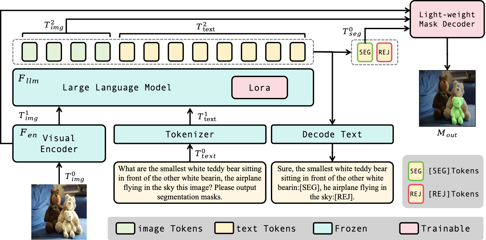
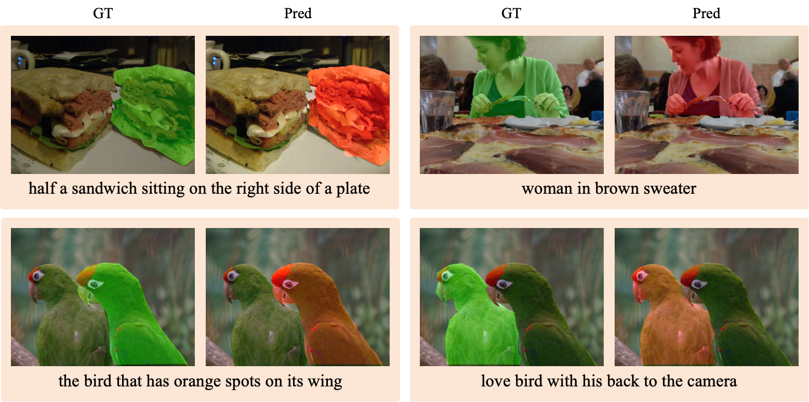
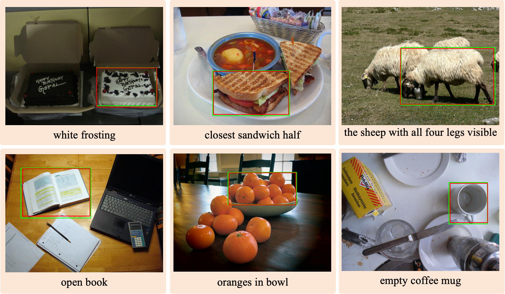
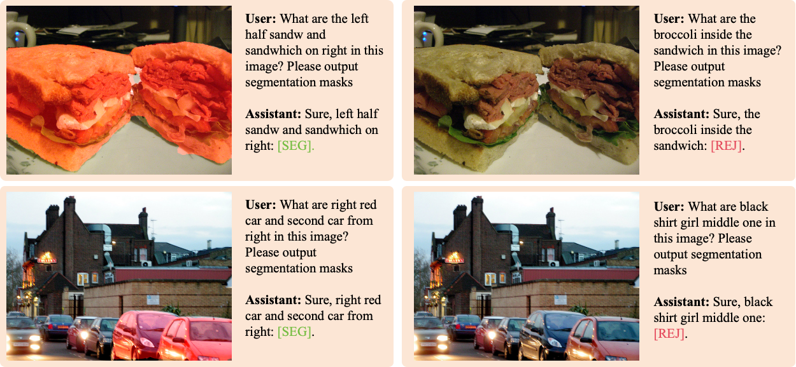

# MLLMSeg: Unlocking the Potential of MLLMs in Referring Expression Segmentation via a Light-weight Mask Decoder

[](http://arxiv.org/abs/2508.04107)
[](https://www.python.org/downloads/)
[](https://pytorch.org/)
[](https://huggingface.co/docs/transformers/)



## Overview

MLLMSeg attaches a lightweight mask decoder to InternVL3.5 for referring expression segmentation (RES), referring expression comprehension (REC), and generalized referring expression segmentation (GRES).

**Table of contents**

- [Installation](#installation)
- [Data Preparation](#data-preparation)
- [Base Model Download](#base-model-download)
- [Training](#training)
- [Evaluation](#evaluation)
- [Checkpoints](#checkpoints)
- [Results](#results)
- [Project Structure](#project-structure)
- [Citation](#citation)

## Installation

### System requirements

| Item | Recommendation |
| --- | --- |
| Python | 3.10 |
| CUDA | 12.x (tested with CUDA 12.8) |
| GPU | 8× GPU for default training config (adjust `GPUS` / `PER_DEVICE_BATCH_SIZE` for fewer GPUs) |

### Step 1: Create conda environment

```bash
conda create -n mllmseg python=3.10 -y
conda activate mllmseg
```

### Step 2: Install PyTorch

Install a PyTorch build that matches your CUDA version. Example for CUDA 12.8:

```bash
pip install torch==2.7.0 torchvision==0.22.0 torchaudio==2.7.0 \
  --index-url https://download.pytorch.org/whl/cu128
```

For CUDA 11.8, use `cu118` and compatible torch / torchvision versions from the [PyTorch website](https://pytorch.org/get-started/locally/).

### Step 3: Install flash-attn

```bash
pip install flash-attn==2.8.2 --no-build-isolation
```

This step requires a CUDA-capable GPU and a working CUDA toolkit.

### Step 4: Install remaining dependencies

```bash
pip install -r requirements.txt
```

`requirements.txt` intentionally excludes `torch` and `flash-attn` so they can be installed according to your CUDA setup.

If `pycocotools` fails to build, try:

```bash
pip install pycocotools --no-build-isolation
# or
conda install -c conda-forge pycocotools
```

## Data Preparation

All datasets are expected under `./data` (configurable via `--base_image_dir` or the `base_image_dir` training argument).

### Directory layout

```text
data/
├── refer_seg/
│   ├── grefcoco/          # gRefCOCO annotations (GRES)
│   ├── refclef/
│   ├── refcoco/
│   ├── refcoco+/
│   └── refcocog/
└── images/
    ├── saiapr_tc-12/      # RefCLEF images
    └── mscoco/
        └── images/
            └── train2014/ # COCO train2014 for refCOCO / refCOCO+ / refCOCOg / gRefCOCO
```

### Dataset sources

| Dataset | Download |
| --- | --- |
| RefCOCO | [refcoco.zip](https://web.archive.org/web/20220413011718/https://bvisionweb1.cs.unc.edu/licheng/referit/data/refcoco.zip) |
| RefCOCO+ | [refcoco+.zip](https://web.archive.org/web/20220413011656/https://bvisionweb1.cs.unc.edu/licheng/referit/data/refcoco+.zip) |
| RefCOCOg | [refcocog.zip](https://web.archive.org/web/20220413012904/https://bvisionweb1.cs.unc.edu/licheng/referit/data/refcocog.zip) |
| RefCLEF | [refclef.zip](https://web.archive.org/web/20220413011817/https://bvisionweb1.cs.unc.edu/licheng/referit/data/refclef.zip) |
| RefCLEF images (saiapr_tc-12) | [saiapr_tc-12.zip](https://web.archive.org/web/20220515000000/http://bvisionweb1.cs.unc.edu/licheng/referit/data/images/saiapr_tc-12.zip) |
| gRefCOCO | [gRefCOCO repo](https://github.com/henghuiding/gRefCOCO) — place expression and annotation JSON files under `data/refer_seg/grefcoco/` |
| COCO train2014 | [COCO 2014 train images](https://cocodataset.org/#download) |

Unpack each referring dataset into `data/refer_seg/<dataset_name>/` and images into the paths shown above.

## Base Model Download

Download InternVL3.5 backbone weights into `./models/`:

```bash
bash download_models.sh
```

Or download a single size manually:

```bash
python -m huggingface_hub.cli.hf download OpenGVLab/InternVL3_5-8B --local-dir models/InternVL3_5-8B
```

## Environment Variables

Scripts read the following optional variables. Defaults work for a standard local setup.

| Variable | Default | Description |
| --- | --- | --- |
| `PROJECT_ROOT` | repository root | Project directory |
| `CONDA_BASE_PATH` | `$HOME/miniconda3` | Conda installation path |
| `CONDA_ENV` | `mllmseg` | Conda environment name |
| `CUDA_PATH` | `/usr/local/cuda` | CUDA toolkit path |
| `GPUS` | `8` | Number of GPUs for distributed training / eval |
| `BATCH_SIZE` | `128` | Global batch size |
| `PER_DEVICE_BATCH_SIZE` | `16` | Per-GPU batch size |
| `LORA_RANK` | `64` | LoRA rank |
| `LR` | `1e-4` | Learning rate |
| `CHECKPOINT` | — | Checkpoint path for evaluation scripts |

Example for a machine with 4 GPUs:

```bash
export GPUS=4
export PER_DEVICE_BATCH_SIZE=8
export CONDA_BASE_PATH=/path/to/miniconda3
```

## Training

Each training script runs the full pipeline end-to-end: **RES train → RES eval → GRES train → GRES eval**.

Training uses DeepSpeed ZeRO Stage 1 (`zero_stage1_config.json`) and writes outputs to `work_dirs/`.

Default hyperparameters (8× GPU):

| Stage | Datasets | Steps | Output dir pattern |
| --- | --- | --- | --- |
| RES | refclef, refcoco, refcoco+, refcocog | 50,000 | `work_dirs/mllmseg_{size}_lora64_b128_...` |
| GRES | grefcoco | 20,000 | `{RES_output_dir}_gres` |

```bash
bash scripts/train_mllmseg_internvl35_1b.sh
bash scripts/train_mllmseg_internvl35_2b.sh
bash scripts/train_mllmseg_internvl35_4b.sh
bash scripts/train_mllmseg_internvl35_8b.sh
```

GRES fine-tuning automatically loads the RES checkpoint from the matching `work_dirs/` folder.

## Evaluation

```bash
# RES — RefCOCO / RefCOCO+ / RefCOCOg / RefCLEF
CHECKPOINT=work_dirs/mllmseg_8b_lora64_b128_pdbs16_gas1_gpu8_lr1e-4 \
  bash scripts/test_mllmseg.sh

# GRES — gRefCOCO
CHECKPOINT=work_dirs/mllmseg_8b_lora64_b128_pdbs16_gas1_gpu8_lr1e-4_gres \
  bash scripts/test_mllmseg_gres.sh
```

You can also evaluate Hugging Face checkpoints directly:

```bash
CHECKPOINT=jcwang0602/MLLMSeg_InternVL3_5_8B_RES bash scripts/test_mllmseg.sh
```

Results are appended to `<checkpoint>/eval_log.txt` and saved as `<checkpoint>/eval_results.csv`.

## Checkpoints

Pre-trained MLLMSeg weights are on [Hugging Face](https://huggingface.co/jcwang0602):

| Model | RES | GRES |
| --- | --- | --- |
| InternVL3.5-1B | [MLLMSeg_InternVL3_5_1B_RES](https://huggingface.co/jcwang0602/MLLMSeg_InternVL3_5_1B_RES) | [MLLMSeg_InternVL3_5_1B_GRES](https://huggingface.co/jcwang0602/MLLMSeg_InternVL3_5_1B_GRES) |
| InternVL3.5-2B | [MLLMSeg_InternVL3_5_2B_RES](https://huggingface.co/jcwang0602/MLLMSeg_InternVL3_5_2B_RES) | [MLLMSeg_InternVL3_5_2B_GRES](https://huggingface.co/jcwang0602/MLLMSeg_InternVL3_5_2B_GRES) |
| InternVL3.5-4B | [MLLMSeg_InternVL3_5_4B_RES](https://huggingface.co/jcwang0602/MLLMSeg_InternVL3_5_4B_RES) | [MLLMSeg_InternVL3_5_4B_GRES](https://huggingface.co/jcwang0602/MLLMSeg_InternVL3_5_4B_GRES) |
| InternVL3.5-8B | [MLLMSeg_InternVL3_5_8B_RES](https://huggingface.co/jcwang0602/MLLMSeg_InternVL3_5_8B_RES) | [MLLMSeg_InternVL3_5_8B_GRES](https://huggingface.co/jcwang0602/MLLMSeg_InternVL3_5_8B_GRES) |

## Results

### Referring Expression Segmentation (cIoU)

| Model | RefCOCO | | | RefCOCO+ | | | RefCOCOg | | Avg |
| --- | --- | --- | --- | --- | --- | --- | --- | --- | --- |
| | val | testA | testB | val | testA | testB | val-u | test-u | |
| InternVL3.5-1B | 80.8 | 82.8 | 78.7 | 74.9 | 79.4 | 69.9 | 79.4 | 80.9 | 78.3 |
| InternVL3.5-2B | 83.5 | 85.2 | 81.1 | 78.7 | 82.7 | 74.5 | 82.1 | 83.6 | 81.4 |
| InternVL3.5-4B | 84.5 | 85.7 | 82.4 | 80.2 | 83.4 | 76.5 | 83.5 | 84.6 | 82.6 |
| InternVL3.5-8B | 84.5 | 85.8 | 82.8 | 80.2 | 83.4 | 76.8 | 83.9 | 85.0 | 82.8 |

### Referring Expression Comprehension (REC)

| Model | RefCOCO | | | RefCOCO+ | | | RefCOCOg | | Avg |
| --- | --- | --- | --- | --- | --- | --- | --- | --- | --- |
| | val | testA | testB | val | testA | testB | val-u | test-u | |
| InternVL3.5-1B | 91.3 | 94.4 | 87.7 | 86.0 | 91.3 | 80.6 | 88.3 | 89.0 | 88.6 |
| InternVL3.5-2B | 93.4 | 96.0 | 90.1 | 89.0 | 93.6 | 83.9 | 89.7 | 90.7 | 90.8 |
| InternVL3.5-4B | 93.9 | 95.7 | 90.6 | 90.0 | 93.6 | 85.7 | 90.9 | 91.2 | 91.4 |
| InternVL3.5-8B | 93.9 | 95.8 | 91.3 | 90.4 | 93.8 | 86.8 | 91.4 | 91.8 | 91.9 |

### Generalized Referring Expression Segmentation (gRefCOCO)

| Model | val | | | testA | | | testB | | |
| --- | --- | --- | --- | --- | --- | --- | --- | --- | --- |
| | gIoU | cIoU | N-acc | gIoU | cIoU | N-acc | gIoU | cIoU | N-acc |
| InternVL3.5-1B | 71.6 | 69.7 | 67.5 | 74.7 | 75.0 | 68.5 | 67.0 | 66.4 | 62.4 |
| InternVL3.5-2B | 75.7 | 72.7 | 73.8 | 77.4 | 77.2 | 72.5 | 69.6 | 68.6 | 64.3 |
| InternVL3.5-4B | 77.1 | 74.0 | 75.2 | 78.6 | 78.5 | 73.5 | 71.5 | 69.7 | 66.2 |
| InternVL3.5-8B | 77.2 | 73.9 | 74.6 | 77.9 | 77.9 | 69.8 | 71.1 | 70.1 | 63.9 |

## Visualization

### Referring Expression Segmentation


### Referring Expression Comprehension


### Generalized Referring Expression Segmentation


## Project Structure

```text
MLLMSeg/
├── assets/                          # Figures for README
├── internvl/                        # InternVL3.5 backbone (vendored)
├── literals/                        # Class name files for auxiliary datasets
├── mllmseg/
│   ├── mllmseg.py                   # MLLMSeg model (InternVL + mask decoder)
│   ├── finetune_mllmseg.py          # Training entry point
│   ├── test_mllmseg_res.py          # RES / REC evaluation
│   ├── test_mllmseg_gres.py         # GRES evaluation
│   ├── dataset*.py                  # Dataset loading & preprocessing
│   ├── refer.py / grefer.py         # Referring dataset APIs
│   └── decoder*.py                  # Lightweight mask decoder
├── scripts/
│   ├── train_common.sh              # Shared training / eval logic
│   ├── train_mllmseg_internvl35_*.sh # Full pipeline per model size
│   ├── test_mllmseg.sh              # RES evaluation launcher
│   └── test_mllmseg_gres.sh         # GRES evaluation launcher
├── utils/                           # Logging, losses, metrics
├── data/                            # Datasets (gitignored; see Data Preparation)
├── models/                          # InternVL3.5 base weights (gitignored)
├── work_dirs/                       # Training outputs (gitignored)
├── download_models.sh               # Download base models from Hugging Face
├── requirements.txt                 # Python deps (excl. torch / flash-attn)
└── zero_stage1_config.json          # DeepSpeed ZeRO-1 config
```

## Acknowledgments

This code builds on [InternVL](https://github.com/OpenGVLab/InternVL), [GSVA](https://github.com/LeapLabTHU/GSVA), and [EEVG](https://github.com/chenwei746/EEVG).

## Contact

Email: jcwang@stu.ecnu.edu.cn

## Citation

```bibtex
@misc{wang2025unlockingpotentialmllmsreferring,
      title={Unlocking the Potential of MLLMs in Referring Expression Segmentation via a Light-weight Mask Decoder},
      author={Jingchao Wang and Zhijian Wu and Dingjiang Huang and Yefeng Zheng and Hong Wang},
      year={2025},
      eprint={2508.04107},
      archivePrefix={arXiv},
      primaryClass={cs.CV},
      url={https://arxiv.org/abs/2508.04107},
}
```
